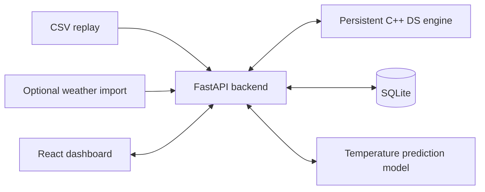

# HeatWatch

## Project purpose

**HeatWatch is a website for monitoring weather observations, exploring historical temperatures, identifying connected hot regions, and predicting next-hour temperature.** It combines a polished dashboard with a backend that uses manually implemented data structures to process and retrieve weather records.

This is a Data Structures mini project aligned with **KJS-CES-01: Climate Intelligence for Heatwave Monitoring**. The central demonstration is a complete journey: a reading arrives, enters a circular queue, is processed and indexed, appears on the dashboard, and becomes available for historical search and prediction.

The project should be useful and visually convincing while remaining small enough for a student to implement, test, and explain in a viva.

## Expected outcome

A user can:

1. Open a dashboard showing monitored locations, recent readings, temperature trends, and alerts.
2. Select a station to inspect its observation history and next-hour prediction.
3. Replay a bundled weather dataset without an internet connection.
4. Search historical records by station and time interval.
5. Identify connected stations exceeding a configurable temperature threshold.
6. Inspect the actual queue, tree, hash table, and traversal operations behind the displayed results.

## Scope and priorities

### Required first version

- 10–20 locations with coordinates and clear data-source labels.
- Offline CSV replay as the dependable demonstration mode.
- Dashboard, station details, history search, alerts, and an integrated DS demonstration panel.
- C++ implementations of the core data structures.
- Persistent observation storage and reconstruction of in-memory indexes after restart.
- A next-hour temperature prediction model evaluated against a persistence baseline.
- Responsive design, useful empty states, loading states, validation, and error messages.
- A reproducible demonstration dataset and documented startup procedure.

### Optional extensions

- Import weather data from an external API.
- Compare two stations side by side.
- Download filtered history as CSV.
- Add a formula editor for a custom demonstration score.
- Compare BST and AVL tree behavior on chronological insertions.
- Add accounts and saved preferences only after the core project is complete.

### Outside the first version

- Physical sensor hardware, SMS delivery, and mobile applications.
- Nationwide coverage or large-scale distributed ingestion.
- Automatic emergency response or official heatwave declarations.
- Chatbots, complex deep learning, or features unrelated to the weather workflow.

## Product experience

### Dashboard

The dashboard is the main demonstration screen. It should communicate conditions at a glance and let users move directly into supporting detail.

- Header: HeatWatch wordmark, selected region, data mode, last update, and replay controls.
- Summary cards: monitored stations, hottest reading, stations above threshold, and queue utilization.
- Main map: station markers colored by configured monitoring bands, with an accessible legend.
- Trends: temperature chart for a selected station, with humidity available as a separate series or chart.
- Recent alerts: concise events with station, reading, threshold, timestamp, and acknowledgement status.
- Expandable DS panel: current structure state and the operations that produced the selected result.

Selecting a marker must update the corresponding station details. Cards, charts, and alerts must agree about the selected time and data mode.

### Station details

- Station ID, name, coordinates, and source type.
- Latest temperature and humidity, including observation time and freshness.
- Historical temperature chart and a selectable time interval.
- Predicted next-hour temperature, target timestamp, and model version.
- Recent observation list and alert history.
- A clear unavailable state when insufficient history prevents prediction.

### Historical explorer

- Filter by station and time range.
- Display observation time, temperature, humidity, and source.
- Sort a snapshot using a manually implemented sorting algorithm.
- Demonstrate binary search on data sorted by the same search key.
- Show the selected BST search path and visited-node count when requested.
- Paginate large results and distinguish no matches from request failure.

### Alerts and hot regions

- Configure an illustrative temperature threshold.
- Create an alert when a station enters the above-threshold state.
- Update the existing active event while that condition continues.
- Resolve the event when the station exits that state; retain the event history.
- Acknowledge an alert without changing its measured condition.
- Use graph traversal to highlight connected groups of currently hot stations.

These are configurable monitoring alerts. They are not official meteorological heatwave classifications.

### DS demonstration panel

Keep this panel collapsed during ordinary use and readily available during evaluation.

| View | What the user sees |
|---|---|
| Circular queue | Slots, front, next insertion index, count, capacity, and accepted/rejected readings |
| Linked list | Recent observations as nodes with next links |
| BST | Timestamp keys, highlighted search path, height, and visited nodes |
| Hash table | Buckets, station keys, chains, collisions, and lookup steps |
| Graph | Adjacency connections, current hot nodes, traversal order, and components |
| Sort and search | Input snapshot, sorted output, comparisons, and binary search interval changes |
| Stack extension | Token scan, operator stack, postfix output, and value stack |

Animations must reflect traces returned by the real engine. Do not generate unrelated frontend animations that merely resemble the algorithm.

## Visual direction

Build a modern environmental monitoring dashboard with generous spacing, readable typography, restrained surfaces, and strong charts.

- Use a light neutral background, dark text, and a deep teal primary color.
- Reserve amber, orange, and red for increasing monitoring bands and warnings.
- Use blue or teal for ordinary readings and selection states.
- Pair every color-coded condition with a text label or icon.
- Prefer a compact navigation sidebar on desktop and a simple collapsible navigation on smaller screens.
- Use subtle transitions for selection and state changes; avoid distracting continuous animation.
- On narrow screens, stack the map, charts, and alerts in a useful reading order.
- Support keyboard navigation, visible focus, readable chart labels, and reduced-motion preferences.

Every data screen needs loading, empty, stale-data, and error states. Use explicit units such as °C and % rather than unlabeled numbers.

## Proposed architecture

Use one local web application backed by a C++ engine. Keep the interfaces small so each part can be explained and tested independently.

| Layer | Proposed choice | Responsibility |
|---|---|---|
| Frontend | React, TypeScript, Vite, Tailwind CSS | Screens, interactions, charts, and algorithm trace playback |
| Map and charts | Leaflet and Recharts | Location display and time-series visualization |
| API | Python with FastAPI | Validation, replay orchestration, persistence, and prediction |
| DS engine | C++17 executable | Manually implemented structures and algorithm operations |
| Persistence | SQLite | Durable stations, observations, alerts, and settings |
| ML | scikit-learn | Training, evaluation, and next-hour inference |

These are implementation choices, not a claim that the lab sheets prescribe a web stack. Verify mini-project language requirements before changing the C++ engine approach.



### Engine communication

Start one persistent C++ process when the backend starts. Exchange newline-delimited JSON commands and responses through standard input and output.

- Every request has a request ID, operation name, and payload.
- Every response has the same request ID, success flag, result, and optional trace.
- Reserve standard output for protocol messages and standard error for diagnostics.
- Serialize access through a backend coordinator so concurrent HTTP requests cannot interleave engine responses.
- Use explicit timeouts and handle malformed responses and process failure.
- Do not launch a new engine process per request; its structures must survive across operations.
- Run the first version with one API worker because that worker owns the engine process.
- If the engine fails, pause processing, restart it, and rebuild its indexes before resuming.

A JSON parsing library is acceptable infrastructure unless the instructor prohibits it. It must not replace the assigned data structures or algorithms.

## Data structure implementation

### 1. Array of structures

Store station metadata and working batches in explicit record structures. Validate duplicate IDs and capacity limits. This connects to Experiment 1: arrays, structures, and pointers.

### 2. Singly linked list

Maintain a bounded recent history for each station with head and tail pointers. Append processed observations at the tail and remove the oldest from the head when the history limit is reached. Both operations are O(1); arbitrary search is O(n).

This is an inspectable recent-history cache, while SQLite retains durable history. It connects to Experiment 2.

### 3. Stack

As an optional extension, accept arithmetic formulas using allowlisted variables such as temperature and humidity. Tokenize the expression, convert infix to postfix using an operator stack, and evaluate postfix with a value stack.

Support a small documented grammar, parentheses, decimal values, and unary minus. Reject unknown symbols, malformed expressions, division by zero, and non-finite results. Never execute the input as code.

Label the result a custom demonstration score unless a recognized meteorological formula, its units, and its valid domain are implemented correctly. This connects to Experiment 3.

### 4. Circular queue

Buffer readings between ingestion and processing using a fixed-capacity array and the counter method from Experiment 4.

- Initialize `front = 0`, `rear = 0`, and `count = 0`.
- Define `rear` as the next insertion slot.
- Empty: `count == 0`; full: `count == capacity`.
- Enqueue at `rear`, advance it modulo capacity, then increment count.
- Dequeue at `front`, advance it modulo capacity, then decrement count.
- Reject a new reading explicitly when full. Do not silently overwrite unread readings.
- Track rejected submissions and processed records separately.

For CSV replay, pause the producer when full and retry the same reading after space becomes available. This produces backpressure without losing the replay sequence.

### 5. Binary search tree

Index recent observations separately for each station using `(timestamp, observation_id)` as the key. Implement insertion, exact search, deletion, inorder traversal, and pruned range traversal.

State complexity as O(h) for search, insertion, and deletion, where h is tree height. A plain BST can become O(n), particularly with chronological insertion. After restart, build a balanced initial shape from sorted persisted keys; this does not make later ordinary BST insertions self-balancing.

Expose height and comparison counts so this limitation is visible. AVL balancing is an extension, not a hidden assumption. This connects to Experiment 5.

### 6. Graph and traversal

Represent stations as vertices and geographic proximity as edges. Construct a static undirected graph using a documented distance threshold and calculated geographic distances.

For hot-region detection, traverse the induced subgraph containing only stations currently above the monitoring threshold. Exclude missing or stale readings according to a configurable freshness window.

Implement BFS and DFS with explicit visited tracking. Display component membership and traversal order. Prefer an adjacency list for the application; an adjacency matrix can be added for comparison with the lab representation.

BFS and DFS find connectivity. They do not prove physical heat propagation, forecast the next affected region, or compute shortest distance on weighted edges. This connects to Experiment 6.

### 7. Sorting and binary search

Implement merge sort for historical snapshots and binary search for a selected sorted key. Keep sorting cost separate from subsequent lookup cost.

- Merge sort: O(n log n) time and O(n) auxiliary space.
- Binary search: O(log n) on the correctly sorted array.
- A one-off search must account for the cost of preparing the sorted data.

Use stable ordering for equal timestamps or temperatures, with observation ID as a deterministic tie-breaker when needed. This connects to Experiment 7.

### 8. Hash table

Implement a station-ID hash table with explicit hashing and collision handling. Use separate chaining with manually implemented nodes for the first version. Display collisions and load factor.

Expected lookup is O(1) under suitable hashing and load; worst-case lookup is O(n). Define a resize policy and rebuild entries correctly during resizing.

Experiment 8 mentions a circular array and discusses chaining. If evaluation requires circular probing specifically, use open addressing with wraparound and tombstones instead. Do not describe chaining as circular probing.

### Implementation boundary

Do not substitute `std::map`, `std::unordered_map`, `std::list`, `std::queue`, or built-in sorting for the assessed implementations. Frameworks, JSON parsing, charting, database access, and ML libraries may support the application.

The custom engine must participate in actual application requests. A database query alone followed by a decorative DS visualization does not satisfy this design.

## Data model

| Entity | Core fields |
|---|---|
| Station | station_id, name, latitude, longitude, source_type, enabled |
| Observation | observation_id, station_id, observed_at, received_at, temperature_c, relative_humidity_pct, source, processing_status |
| Prediction | prediction_id, station_id, generated_at, target_at, predicted_temperature_c, model_version |
| Alert | alert_id, station_id, opened_at, updated_at, resolved_at, threshold_c, peak_temperature_c, acknowledged_at |
| Station edge | station_a, station_b, distance_km, adjacency_threshold_km |
| Settings | replay_speed, queue_capacity, history_limit, threshold_c, freshness_window_minutes |

- Store timestamps in UTC and render them in the selected display timezone.
- Distinguish observation time from arrival time.
- Validate coordinates, numeric values, station existence, and humidity in the range 0–100%.
- Apply a documented duplicate policy, such as one reading per station, timestamp, and source.
- Preserve provenance: simulated sensor, imported model/reanalysis data, and direct observations are distinct source types.
- Keep demo sessions separate so resetting a replay does not delete unrelated imports.

## Observation processing and recovery

1. Validate an incoming record and its source.
2. Check for duplicates and available queue capacity through the coordinator.
3. Persist the accepted record with pending status.
4. Enqueue it in the C++ circular queue.
5. The consumer updates the linked history and BST, evaluates threshold state, and requests prediction when enough history exists.
6. Mark the record processed and persist any derived alert or prediction.
7. Update the dashboard and expose the operation trace when requested.

Persistence and engine mutation are not one atomic transaction. Use observation IDs and idempotent processing to recover safely. If persistence succeeds but enqueue fails, retain the pending record for retry. After restart, rebuild processed indexes and enqueue pending records in chronological order up to capacity, loading more as processing continues.

For history search, restore the requested station/time window from SQLite when it is outside the engine cache, build the appropriate engine index, and execute the demonstrated search there. Clearly distinguish loading time from algorithm execution time.

## AI component

### Prediction target

Predict temperature one hour after the latest usable hourly observation for a station. Call this next-hour temperature prediction; it is not automatically a validated heatwave forecast.

### Candidate inputs

- Current temperature and humidity.
- Temperature lagged by one, two, and three hours.
- Trailing temperature average computed only from already available observations.
- Hour of day and day of year encoded as cyclical features.

Only produce a prediction when the required hourly history is available. Do not silently treat missing hours as consecutive readings.

### Training and evaluation

1. Prepare a documented hourly dataset and source attribution.
2. Construct each target from the next hour within the same station series.
3. Split chronologically into training, validation, and held-out test intervals.
4. Fit preprocessing only on training data and prevent future observations from entering features.
5. Start with linear regression; compare a small tree-based regressor only if useful.
6. Compare against the persistence baseline: next-hour temperature equals the latest temperature.
7. Report MAE in °C, sample counts, test dates, and per-station results where feasible.
8. Save the model, feature definition, evaluation report, and model version.

Do not claim improvement until measured. If the trained model underperforms the baseline, report that result honestly. Do not display invented accuracy or confidence percentages.

### Data source

The application must ship with an attributed offline sample. Open-Meteo is a candidate for additional historical imports: https://open-meteo.com/en/docs/historical-weather-api.

Its historical product includes model/reanalysis data. Geographic sample locations from that source must not be presented as physical sensors owned by this project. Check current usage terms before enabling a live integration.

## API contract

Prefix application routes with `/api`. Return consistent validation and error responses.

| Method | Route | Purpose |
|---|---|---|
| GET | /api/health | Backend, database, engine, and model status |
| GET | /api/dashboard | Summary cards, current conditions, and freshness |
| GET | /api/stations | Station metadata and latest readings |
| GET | /api/stations/{id} | Details for one station |
| GET | /api/stations/{id}/observations | Filtered history with pagination |
| POST | /api/observations | Submit a reading and return acceptance status |
| GET | /api/stations/{id}/prediction | Latest available next-hour prediction |
| GET | /api/alerts | Active or historical monitoring events |
| PATCH | /api/alerts/{id} | Acknowledge an event |
| GET | /api/graph/components | Connected hot-station groups |
| POST | /api/replay/start | Start a selected bundled replay session |
| POST | /api/replay/pause | Pause ingestion while preserving position |
| POST | /api/replay/reset | Reset the selected demo session explicitly |
| PATCH | /api/settings | Update validated monitoring settings |
| GET | /api/engine/state | Bounded structure snapshots for demonstration |
| POST | /api/engine/demo/search | Execute a real search and return its trace |
| POST | /api/formulas/evaluate | Optional safe arithmetic evaluation |

Begin with short polling for dashboard updates. Add server-sent events only if polling becomes a concrete limitation. Separate queue acceptance from completed processing in all responses.

## Repository structure

```text
heatwatch/
  PROJECT.md
  README.md
  frontend/
    src/
      components/
      pages/
      features/
        dashboard/
        stations/
        history/
        alerts/
        ds-inspector/
      lib/
      styles/
  backend/
    app/
      api/
      services/
      engine_client/
      models/
      main.py
    tests/
  engine/
    include/
    src/
      circular_queue.cpp
      linked_list.cpp
      bst.cpp
      hash_table.cpp
      graph.cpp
      sorting.cpp
      protocol.cpp
    tests/
    CMakeLists.txt
  ml/
    train.py
    evaluate.py
    artifacts/
  data/
    sample/
    attribution.md
  docs/
    architecture.md
    evaluation.md
    demo-script.md
```

Add a stack implementation only when the formula extension is scheduled. Do not create empty modules merely to make the repository appear larger.

## Build milestones

| Milestone | Work | Completion evidence |
|---|---|---|
| 1. Foundation | Define records, seed stations, select sample data, establish frontend/API/engine communication | A station record travels from engine through API to screen |
| 2. Ingestion | Circular queue, replay producer, processing consumer, persistence, and recovery | Pause, fill, drain, and resume the queue without silent loss |
| 3. Retrieval | Linked history, hash lookup, BST operations, sorting, and binary search | UI results agree with known sample answers and engine traces |
| 4. Dashboard | Map, charts, station details, history, alerts, and responsive states | Complete offline user journey through all required screens |
| 5. Graph analysis | Adjacency construction, BFS/DFS, freshness filtering, hot components | Known synthetic graph produces expected connected groups |
| 6. Prediction | Feature pipeline, chronological evaluation, baseline, saved model, inference | Reproducible held-out MAE and correctly timestamped predictions |
| 7. Demonstration | DS inspector, reset/replay workflow, documentation, final checks | A repeatable demonstration from a clean startup |

Build one working vertical slice early. Expand its capabilities after ingestion, processing, storage, and display work together.

## Verification

### Core algorithm checks

- Circular queue: empty removal, full insertion, wraparound, and repeated fill/drain cycles.
- Linked list: empty and one-node histories, append, oldest removal, and cleanup.
- BST: leaf/one-child/two-child deletion, equal timestamps, missing keys, range boundaries, and skewed input.
- Hash table: deliberate collisions, absent IDs, duplicate insertion, deletion, and resize.
- Graph: disconnected vertices, cycles, isolated hot stations, stale nodes, and deterministic traversal order.
- Sorting/search: empty input, duplicates, already sorted input, reverse order, and absent targets.
- Optional formula stack: precedence, associativity, unary minus, invalid syntax, and division by zero.

### Integration checks

- A submitted reading reaches storage, engine state, and dashboard consistently.
- Queue overflow produces an explicit response and a visible counter.
- Duplicate records do not create repeated history or alerts.
- Restarting the backend reconstructs indexes and resumes pending work.
- Engine failure yields a clear degraded state and a controlled recovery.
- Replay pause/resume and reset operate only on the selected session.
- A fresh offline startup supports the entire demonstration without remote tiles or API access; use a local schematic location view when map tiles are unavailable.

### Prediction checks

- No chronological leakage or crossing between station series.
- Prediction target timestamps are exactly one hour ahead.
- Missing inputs produce an unavailable result rather than fabricated values.
- Baseline and trained model are evaluated on the same held-out examples.

For performance demonstrations, compare identical inputs and report algorithm operation counts alongside measured timings. Keep IPC, database loading, and rendering overhead separate from engine algorithm time. Do not infer asymptotic complexity from a single timing.

## Demonstration script

1. Start HeatWatch with the bundled dataset and show the source label.
2. Begin replay and watch readings enter and leave the circular queue.
3. Pause processing, fill the queue, show an explicit overflow, and resume.
4. Select a station and inspect its chart and linked recent history.
5. Search a station ID and show a collision-handled hash lookup.
6. Search a time interval and highlight BST nodes visited.
7. Sort a historical snapshot and demonstrate binary search.
8. Raise several adjacent stations above the demonstration threshold and highlight their connected component.
9. Show a next-hour prediction and the held-out evaluation against the baseline.
10. Restart the backend and demonstrate persistence and index reconstruction.

## Definition of done

- All required screens use backend data and agree about timestamps and selection.
- The C++ engine performs the assessed operations used by the application.
- The circular queue, history list, BST, hash table, sorting/search, and graph traversal are implemented and verified.
- Source provenance and simulated data are clearly labeled.
- Alerts and graph results are described within their actual capabilities.
- Prediction results include reproducible evaluation and a baseline comparison.
- Empty states, overflow, missing history, engine failure, and restart behavior are handled.
- The application can run and be demonstrated offline from documented setup steps.
- The README explains installation, commands, architecture, data source, and limitations.
- The student can explain each structure's role, invariants, edge cases, complexity, and tradeoffs.

## Submission deliverables

1. Complete frontend, backend, C++ engine, and ML source.
2. Bundled demonstration dataset with attribution.
3. Saved model and reproducible evaluation report.
4. Setup README and architecture documentation.
5. Core algorithm and integration verification results.
6. Screenshots and a short demonstration recording.
7. Mini-project report mapping features to experiments and learning outcomes.

**Success means one coherent weather application whose data structure choices can be observed, measured, and explained.**
